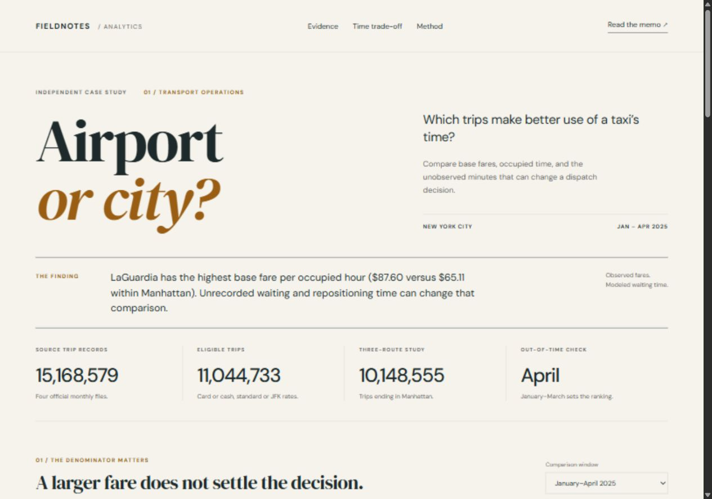

# Airport or City?

[Portfolio PDF - 8 pages](output/pdf/Nakata_Portofolio_Data_Analyst_Airport_or_City.pdf) | [Dashboard](https://nakata-airport-or-city.vercel.app/) | [Full raw CSV download](https://github.com/Nnaely/project-portofolio-operasi-transportasi/releases/download/v1.0.0/data-mentah-nyc-tlc-jan-apr-2025.zip) | [Bahasa Indonesia](README_ID.md)



## Get the project

```text
git clone https://github.com/Nnaely/project-portofolio-operasi-transportasi.git
cd project-portofolio-operasi-transportasi
```

A fresh clone includes code, saved results, executed notebooks, documentation, and portfolio PDFs. Full trip CSVs are downloadable from [Releases](https://github.com/Nnaely/project-portofolio-operasi-transportasi/releases/tag/v1.0.0); extract the CSV archive into the repository root. For analysis, run the official Parquet downloader followed by the analysis script. See [data/raw/README.md](data/raw/README.md).


*Documentation by Nakata - Making this study easier to understand.*

**Taxi Shift Economics · Independent Data Analyst / Business Analyst portfolio project**

[Explore the live study](https://nakata-airport-or-city.vercel.app/)

[Baca panduan lengkap dalam bahasa Indonesia](README_ID.md). Full raw CSV exports can be downloaded into `data/raw/`; see [the raw-data guide](docs/PANDUAN_DATA_MENTAH_ID.md).

Should a taxi operator investigate airport staging, or concentrate on trips within Manhattan? This study uses **15,168,579 reported NYC Yellow Taxi trips from January–April 2025** to compare recorded base fare with occupied time. It then makes the missing waiting and repositioning time explicit as a scenario.

The decision deliverable is a measurement and pilot proposal. The public trip files cannot establish full-shift earnings, driver profit or the effect of changing dispatch.

## Findings

The primary filters retain **11,044,733 trips**. Of those, **10,148,555** belong to the three comparison routes. April provides this held-out comparison:

| April route | Trips | Mean base fare | Mean occupied minutes | Base fare / occupied hour |
|---|---:|---:|---:|---:|
| LaGuardia to Manhattan | 71,029 | $43.41 | 31.24 | $83.39 |
| JFK to Manhattan | 75,303 | $70.17 | 53.56 | $78.60 |
| Manhattan to Manhattan | 2,531,836 | $13.42 | 12.53 | $64.31 |

LaGuardia's point-estimate lead persists from January–March into April, and the broader-filter sensitivity retains the route ordering. However, the operating decision depends on unobserved time. Against a Manhattan benchmark with **zero assumed extra time**, only **9.27 additional minutes per LaGuardia trip** would bring the April rates to parity. If Manhattan instead has **10 assumed extra minutes per trip**, that threshold becomes **41.61 minutes**. Neither figure is an observed queue time.

**Proposed decision:** measure complete vehicle cycles before testing a dispatch change. The evidence supports a measurement priority; it does not establish a profit gain.

## Start with the decision

- [Executive memo](reports/EXECUTIVE_MEMO.pdf): three pages of findings, limitations and a proposed operational test.
- [Interactive study](dashboard/dist/index.html): route comparisons, period selector, hourly patterns and an editable time scenario. Open locally in a browser, or serve the folder as below.
- [Bahasa Indonesia guide](START_HERE_ID.md): how to explore, explain and prepare this project for a portfolio.
- [Executed notebook](notebooks/01_route_economics.ipynb): analytical walkthrough with saved outputs.

## Business contract

| Item | Definition |
|---|---|
| Stakeholder | A hypothetical taxi fleet operations manager deciding what to measure before testing staging recommendations. |
| Unit | One reported trip row. No stable public trip ID is available, so no invented deduplication is performed. |
| Routes | JFK to Manhattan, LaGuardia to Manhattan, and Manhattan to Manhattan, using the official zone lookup. |
| Primary metric | Total `fare_amount` / total occupied minutes × 60. This is base fare per occupied hour, in USD. |
| Calibration | January–March 2025. |
| Validation | April 2025, kept separate from calibration. |
| Decision boundary | An observed fare advantage is a reason to measure full vehicle cycles, not proof that reallocating taxis will improve profit. |

## Data and analytical safeguards

The four Parquet files and taxi zone lookup come directly from [NYC TLC](https://www.nyc.gov/site/tlc/about/tlc-trip-record-data.page). Their hashes, byte sizes, retrieval times and URLs are recorded in `data/source_manifest.json`. Re-downloads must match those hashes. If the publisher revises a file, the downloader stops and preserves the original manifest for review. See [source terms and attribution](NOTICE.md).

The primary cohort has a declared date window and plausibility rules for duration, distance, fare, location, payment and rate code. Its exclusion waterfall reconciles to the source count. Trips touching the March 9 daylight-saving transition date are excluded because the recorded timestamps have no UTC offset. A broader-filter sensitivity checks whether the route ordering depends on the cutoffs.

The project uses a ratio of totals rather than the mean of per-trip rates. That prevents very short trips from receiving disproportionate weight. It separates base fare from passenger charges, excludes cash-tip inference, uses paired calendar-day bootstrap intervals, and validates the route ordering in April. Waiting-time assumptions stay separate from observed quantities.

## Reproduce the analysis

Use Python 3.12 or newer. The source downloads total roughly 257 MB (decimal bytes). Allow additional disk space for the local DuckDB database. Internet access is needed for the first source download; the saved outputs and dashboard can be inspected without recomputing the data.

From the project folder:

```powershell
python -m venv .venv
.\.venv\Scripts\Activate.ps1
python -m pip install -r requirements.txt
python scripts/download_data.py
python scripts/analyze.py
python -m unittest discover -s tests -v
python scripts/build_notebook.py
python reports/build_memo.py
python reports/build_memo_id.py
python reports/build_portfolio_pdf.py
python package_project.py
```

On macOS or Linux, activate the environment with `source .venv/bin/activate` before running the remaining commands. If PowerShell activation is restricted, use `.venv\Scripts\python.exe` directly; changing your execution policy is not required.

To inspect the dashboard through a local server:

```text
python -m http.server 8080 --directory dashboard/dist
```

Open `http://localhost:8080`. Stop the server with Ctrl+C when finished. To rerun only the source-independent unit tests, install the requirements and run the test command; downloading the trip records is not required.

## Repository map

```text
data/source_manifest.json    Source URLs and content hashes
scripts/download_data.py     Fetch and verify official inputs
scripts/analyze.py           Execute SQL, aggregate, validate and export
sql/01_trip_mart.sql         Eligibility, routes and trip-level data model
sql/02_business_questions.sql SQL examples for the business questions
tests/                      Small fixtures for analytical failure modes
notebooks/                  Executed explanation and investigation
outputs/                    JSON, CSV tables, charts and quality evidence
docs/                       Metric definitions, methodology and pilot plan
reports/                    Executive PDF and its reproducible builder
dashboard/dist/             Standalone interactive study
package_project.py          Refresh dashboard and create a portable ZIP
```

Raw trip files and the local database are intentionally excluded from the portable package and Git. The download script reconstructs the input folder. The package contains aggregates and source metadata, not a copy of the full trip dataset.

## What a reviewer can inspect

| Capability | Evidence |
|---|---|
| Business framing | One decision question, measurable outcomes and an explicit data gap. |
| SQL and data modeling | Parquet ingestion, dimension joins, a documented row grain, conditional eligibility and grouped metrics. |
| Data quality | Reconciled exclusions, source hashes, conservation checks and test fixtures. |
| Statistical reasoning | Ratio-of-sums estimand, paired day bootstrap, temporal holdout and sensitivity analysis. |
| Communication | Interactive comparison, executive memo and an honest measurement proposal. |

This is an independent historical project, not work performed for NYC TLC or a transport company. There is no implemented pilot or claimed cost saving. See [methodology](docs/METHODOLOGY.md), [data dictionary](docs/DATA_DICTIONARY.md), and [experiment plan](docs/EXPERIMENT_PLAN.md) before interpreting the charts.
